# 遠端串流筆記：Sunshine + Moonlight + Tailscale

> 📥 懸浮豬寶按鍵：[`Moonlight按鍵.ahk`](Moonlight按鍵.ahk) ＋ [`pig.png`](pig.png)（下載後放同一個資料夾）

> 2026/10/23 實作紀錄。從「挑選遠端工具」開始，一路做到安裝、配對、從外面連回家、連朋友的電腦，最後自己做了一個懸浮按鍵選單。


> [!CAUTION]
> **⚠️ 玩有反作弊的遊戲前必看**
>
> 有些線上遊戲（例如 AVA）的反作弊系統會擋掉巨集工具，開遊戲時跳出：
>
> > Security Error　Code: E019100B
> > 與遊戲無關的程式運行時發生的錯誤。終止與遊戲無關的程式後再啟動遊戲。
>
> **原因**：反作弊偵測到背景有 **AutoHotkey（豬寶按鍵）** 在執行。
> 它是巨集工具，就算畫面上看不到豬寶，只要背景有在跑就會被擋。
>
> > 實測 **Tailscale 不會被 AVA 擋**，可以一直開著，不影響從外面連回家。
>
> **解法：豬寶改成「跟著 Moonlight 開關」**
>
> 新版 `Moonlight按鍵.ahk` 會在你開啟它時順便打開 Moonlight，**關掉 Moonlight 時豬寶自動結束**，平常不會留在背景。
>
> 1. 刪掉開機啟動：`Win + R` 輸入 `shell:startup`，刪掉「Moonlight按鍵 - 捷徑」。
> 2. 對 `Moonlight按鍵.ahk` 按右鍵 → 建立捷徑 → 拖到桌面，改名「Moonlight（豬寶）」。
> 3. 以後要遠端就點這個捷徑，不要點原本的 Moonlight 圖示。
>
> | 時機 | 背景有沒有 AutoHotkey | 玩 AVA |
> |---|---|---|
> | 開機後、沒開 Moonlight | ❌ 沒有 | ✅ 正常 |
> | 用捷徑開了 Moonlight | ✅ 有（串流時畫面出現豬寶） | ⚠️ 會被擋，先關 Moonlight |
> | 關掉 Moonlight | ❌ 自動結束 | ✅ 正常 |
>
> **臨時處理**：如果遊戲已經跳錯誤，系統匣綠色 **H** 右鍵 → **Exit**，再重開遊戲。
>
> **不想用豬寶**：可以完全不裝 AutoHotkey，改用 Moonlight 內建快捷鍵（見第 8-1 節「正常用法」）。
>
> 不要嘗試用改檔名、編譯成 exe 等方式躲過反作弊，可能會被判定作弊而封帳號。


---

## 1. 先決定要用什麼遠端工具

一開始想用 Windows 內建的「遠端桌面（RDP）」，但它有兩個限制：

- **被連的那台要是 Windows 專業版（Pro）以上**，家用版只能連別人、不能被連。
- RDP 是為辦公設計的，**玩遊戲會卡**（約 30fps、3D 遊戲滑鼠亂飄、有些遊戲偵測到遠端桌面直接不給開）。

因為主要用途是**玩遊戲**，所以改用遊戲串流工具。比較過的選擇：

| 工具 | 特色 | 適合 |
|---|---|---|
| Steam Remote Play | 最簡單，Steam 遊戲幾乎免設定 | 只玩 Steam 遊戲 |
| Parsec | 設定容易、延遲低，連朋友電腦很方便 | 入門、偶爾連朋友 |
| **Sunshine + Moonlight** | 免費開源，畫質最好、延遲最低 | **最後選這個** |
| AnyDesk / TeamViewer | 輸入 ID 就能連，最簡單 | 辦公、幫人修電腦（不適合遊戲） |

### 分工：誰裝什麼

- **Sunshine** → 裝在**被連的電腦**（有顯示卡、真正跑遊戲的那台），負責把畫面「傳出去」。
- **Moonlight** → 裝在**拿來玩的裝置**（筆電、手機、平板），負責「接收畫面」並把操作傳回去。

可以想成：Sunshine 是電視台在發送訊號，Moonlight 是你家的電視在收看。
同一台電腦**兩個都裝**也可以：要被連靠 Sunshine，要連別人靠 Moonlight（但不能自己連自己）。

### 安全嗎？

兩個都是開源軟體，本身是安全的，風險在於「怎麼下載」和「怎麼開放連線」：

1. **只從官方下載**：Sunshine 從 GitHub 的 `LizardByte/Sunshine`，Moonlight 從 `moonlight-stream.org`。
2. **配對機制**：每台新裝置第一次連都要輸入 PIN，陌生人連不進來。
3. **Sunshine 管理頁的密碼不要太簡單**。
4. **不要在路由器開連接埠對外**，要從外面連用 Tailscale（第 5 節）。

---

## 2. 被連的電腦：安裝 Sunshine

### 2-1 下載

到 GitHub 的 [**LizardByte/Sunshine** → Releases](https://github.com/LizardByte/Sunshine/releases)，找標著 **Latest** 的最新版。

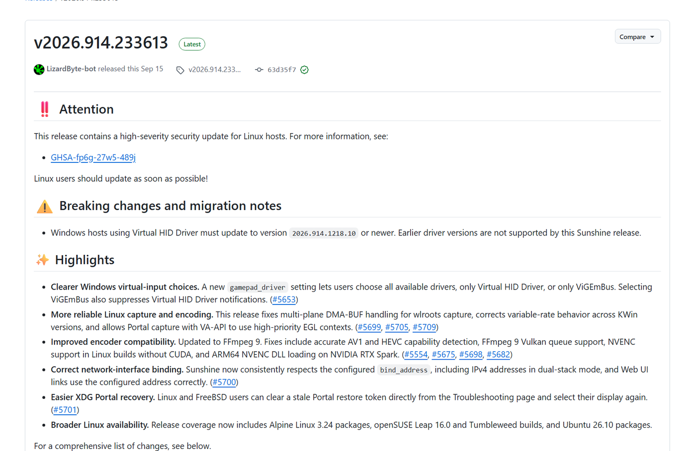


發布說明重點：
- 最上面的「高嚴重性安全更新」是 **Linux 專屬**，Windows 不受影響。
- 「Virtual HID Driver 要更新」是給舊版升級的人看的，全新安裝照預設即可。

往下捲到 **Assets**，下載 **`Sunshine-Windows-AMD64-installer.msi`**（紅框）：

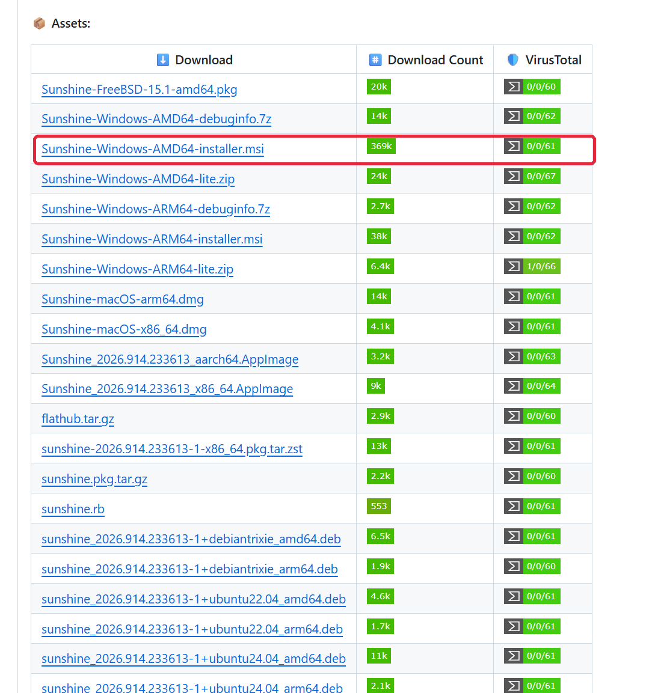


右邊 VirusTotal 的 `0/0/61` 表示 61 家防毒引擎都沒偵測到問題。

> [!NOTE]
> **怎麼判斷要下載哪個檔案？看檔名三個線索：**
>
> 1. **作業系統**：`.exe` / `.msi` / 檔名有 Windows → Windows；`.dmg` → Mac；`.AppImage` / `.deb` / `.rpm` → Linux。
> 2. **處理器架構**：`x64` = `x86_64` = `AMD64`（一般 Intel / AMD 電腦，Intel 也選這個）；`arm64` / `aarch64` 是 ARM 筆電用的。不確定就看「設定 → 系統 → 系統資訊 → 系統類型」。
> 3. **安裝版或免安裝版**：檔名有 `Setup` / `installer` → 安裝版（一般選這個）；`Portable` / `lite` / `.zip` → 免安裝版；`Src` / `Source code` / `debuginfo` → 給開發者的，跳過。

預設安裝位置：`C:\Program Files\Sunshine`（設定和配對紀錄在裡面的 `config` 資料夾，不要亂刪）。

### 2-2 建立管理帳號密碼

安裝完打開 `https://localhost:47990`，第一次會要求建立帳號密碼：

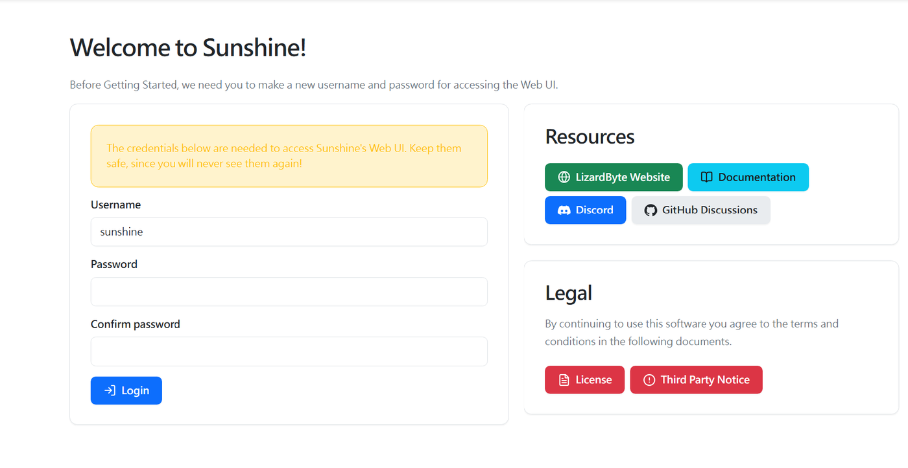


- Username 預填 `sunshine`，可以直接用。
- 密碼輸入兩次，**記下來**（黃框提醒：之後不會再顯示）。

瀏覽器出現紅色「**不安全**」是正常的：


`localhost` 是自己電腦連自己，資料沒有傳到網路上；顯示不安全只是因為 Sunshine 用自簽憑證。

### 2-3 手把驅動

登入後首頁會提示選擇 Windows 手把驅動：

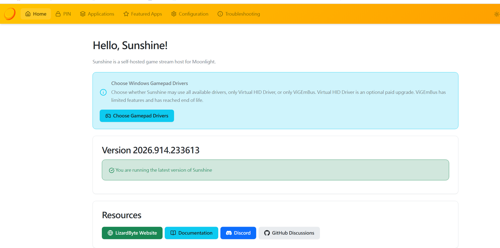


- **Virtual HID Driver**：付費升級，功能較完整（PS5 手把觸控板、陀螺儀等）。
- **ViGEmBus**：免費，功能較少、已停止維護，但一般手把夠用。
- **不用手把** → 不用理它；**會用手把、不想付費** → 選 ViGEmBus（還能關掉付費提醒）。

---

## 3. 連線端：安裝 Moonlight

### 3-1 電腦版

到 GitHub 的 [**Moonlight Game Streaming Project**](https://github.com/moonlight-stream)（有 Verified 認證）→ 點 [**moonlight-qt**](https://github.com/moonlight-stream/moonlight-qt/releases)（電腦版）：

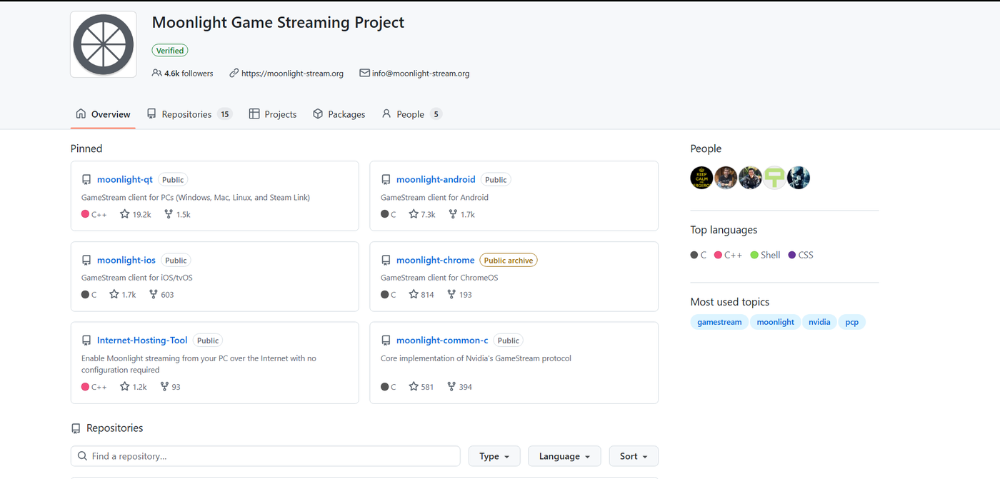


右側 Releases → Latest → Assets，下載 **`MoonlightSetup-x.x.x.exe`**（約 53 MB）：

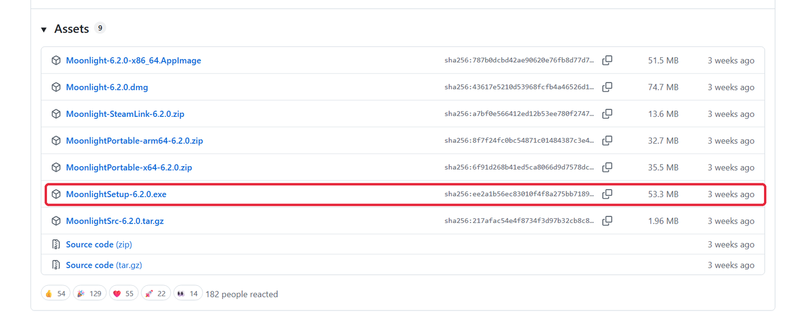


### 3-2 手機版

| 手機 | 用什麼 | 說明 |
|---|---|---|
| Android | 官方 **Moonlight Game Streaming**（Google Play） | 免費、自動更新 |
| Android | **月光·阿西西**（GitHub `Axixi2233/moonlight-android`） | 非官方修改版：虛擬按鍵、快捷指令、多種滑鼠模式、方便叫鍵盤。要自己下載 `.apk` 安裝，不會自動更新 |
| iPhone | 官方 **Moonlight Game Streaming**（App Store） | 免費 |
| iPhone | **VoidLink**（App Store，付費） | 社群分支，功能類似阿西西 |

> [!WARNING]
> - 手機商店認明開發者 **Moonlight Game Streaming Project**，有山寨 App。
> - 阿西西是非官方版本，只從作者 GitHub 下載，不要用網盤或論壇載點。
> - 安裝 `.apk` 時要允許 Chrome「安裝未知應用程式」，裝完可以再關掉。

---

## 4. 在家（同一個網路）配對與連線

1. 兩台在同一個 Wi-Fi，打開 Moonlight，通常會自動出現被連的電腦；沒出現就按 **＋** 手動輸入它的區網 IP（在被連電腦用 `ipconfig` 查 `IPv4 位址`，通常是 `192.168.x.x`）。
2. 鎖頭圖示代表**還沒配對**：

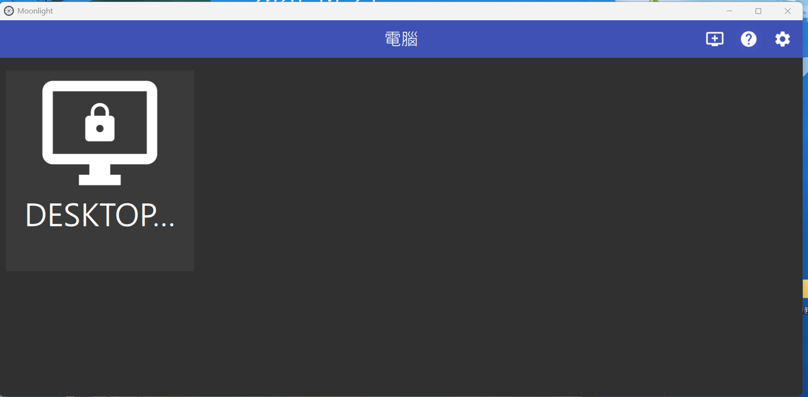


3. 點它 → 畫面出現 4 位數 **PIN**。
4. 到**被連的電腦**打開 `https://localhost:47990` → 上方 **PIN** → 輸入 PIN、幫裝置取名字 → 送出。
5. 鎖頭消失，點進去選 **Desktop** 就連上了。配對只要做一次。

> [!CAUTION]
> **常見錯誤：Error 409**
>
> 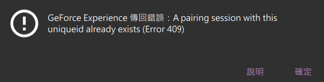
>
>
> 意思是那台電腦已經有一個「配對中」的請求還沒完成（點了配對沒輸入 PIN 又再點一次，或兩台裝置同時配對）。
> 解法：被連電腦重啟 Sunshine（管理頁 Troubleshooting → Restart，或直接重開機）→ 只點一次 → 馬上輸入 PIN。
> 另外注意不要點到**自己這台**（Moonlight 會自動掃到同台電腦的 Sunshine），可以右鍵刪除。

### 結束連線

離開串流畫面後，如果看到 ▶ 和 ■ 兩個按鈕，代表工作階段**還沒結束**：


- ▶：回到畫面繼續用
- ■：**完全結束**（聲音也會回到被連的電腦）

此時被連電腦系統匣的 Sunshine 圖示會顯示暫停狀態：


Sunshine 圖示：一般太陽 = 待命；太陽＋播放 = 有人在串流；太陽＋暫停 = 有人離開但沒結束。

---

## 5. 從外面連回家：Tailscale

### 為什麼需要

在家時兩台接同一台路由器、看得到彼此；人在外面時中間隔著網際網路，Moonlight 找不到家裡電腦。
Moonlight 官方做法是**路由器開埠轉發**，但等於把電腦的門開在網路上。改用 **Tailscale**：每台裝置裝好、登入同一個帳號，就像被拉進同一個「虛擬區網」，不用動路由器，個人使用免費。

> Tailscale 不是 Moonlight 官方寫的方法，但社群很常用；「分享電腦給別人」則是 Tailscale 官方功能。

### 5-1 註冊與問卷

到 `tailscale.com` 註冊（Google 帳號即可），問卷選 **personal use** → **Personal or at-home use**（選什麼都不影響功能）：

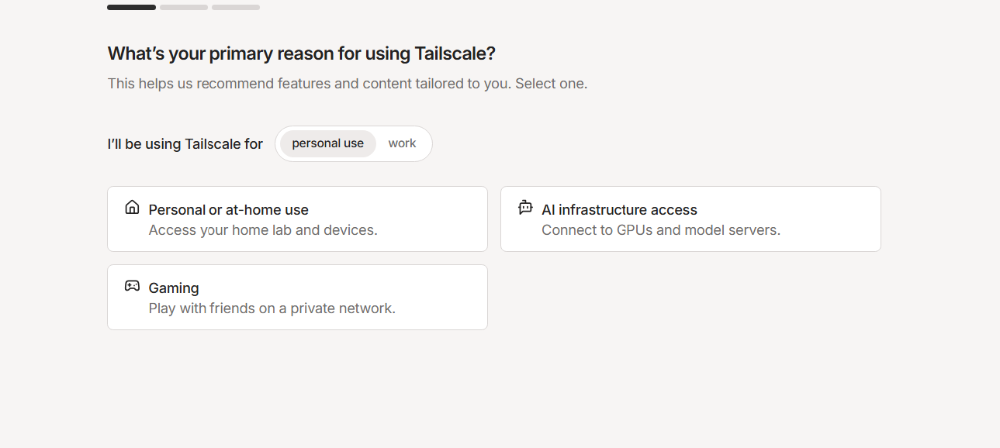


### 5-2 網頁後台 ≠ 程式

註冊完會看到網頁後台（Machines 頁），一開始是空的：

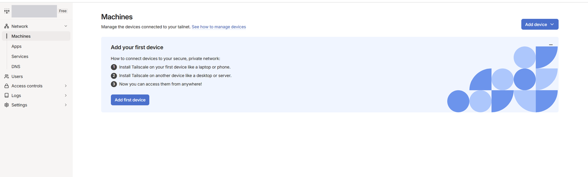


網頁後台只是「控制台」，**每台要互連的裝置都要另外安裝 Tailscale 程式**。點 **Add first device** 下載 Windows 版安裝。

### 5-3 在遊戲電腦登入

安裝完點 **Sign in to your network**（已有帳號，不要點 Sign up），用同一個帳號登入：

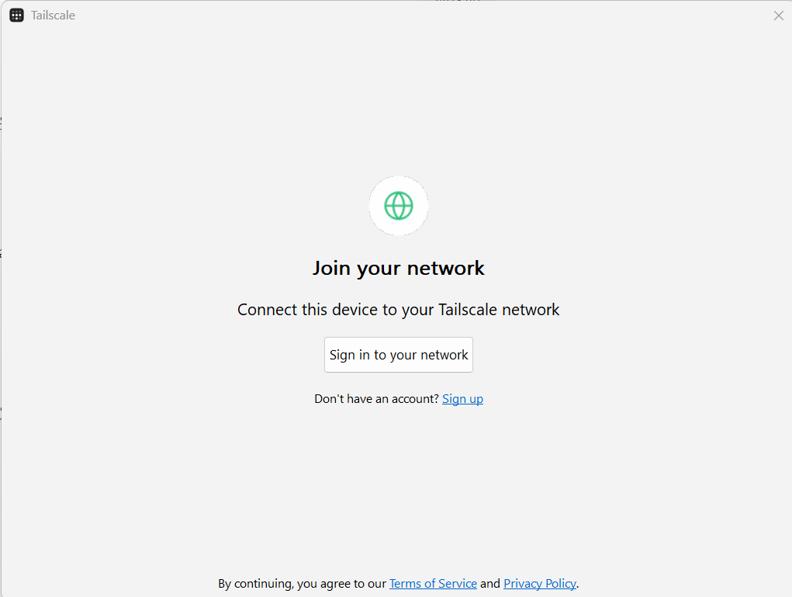


回到後台重新整理，看到電腦出現且是 **Connected**：

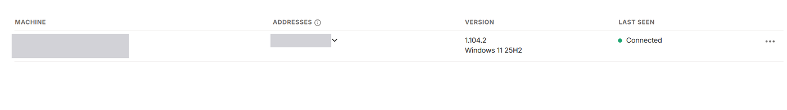


記下它的 **`100.x.x.x`** IP，之後在外面用 Moonlight 連回來就是輸入這組（固定不變）。

### 5-4 遊戲電腦必做的三個設定

| 設定 | 怎麼做 | 為什麼 |
|---|---|---|
| **Disable key expiry** | 後台 Machines → 該電腦右邊「…」→ Disable key expiry | 預設約半年要重新登入，人在外面剛好過期就連不回來 |
| **Run unattended** | 系統匣 Tailscale 圖示右鍵 → Preferences → 勾選 | 預設要有人登入 Windows 才會連線；勾了之後重開機停在登入畫面也連得進來 |
| **不要睡眠** | 設定 → 系統 → 電源 → 接上電源時睡眠「永不」 | 人在外面沒辦法按電源 |

系統匣 = 螢幕右下角時鐘旁的小圖示區，找不到就點 **^** 展開。

### 5-5 手機 / 外出裝置

1. 安裝 Tailscale，登入**同一個帳號**（帳號 = 同一個私人網路，不同帳號看不到彼此）。
2. 把開關打開（Connected）。不玩時可以關掉省電。
3. Moonlight 按 **＋** 輸入遊戲電腦的 `100.x.x.x`。

> [!WARNING]
> 用行動網路時，Moonlight 首頁會一直轉圈「正在您的區域網路中搜尋主機電腦」：
>
> 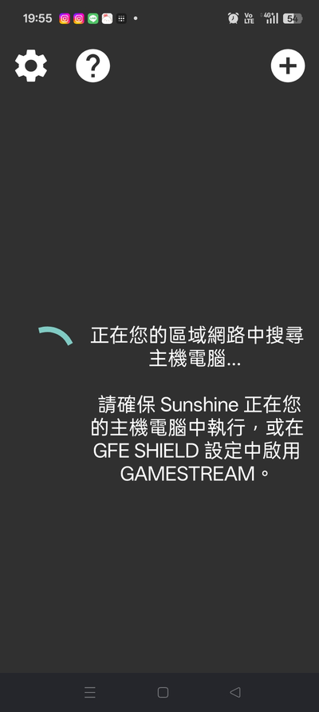
>
>
> 這是正常的，自動搜尋只找同一個 Wi-Fi 的電腦。**直接按右上角 ＋ 手動輸入 `100.x.x.x`** 即可。

### 5-6 連不上時檢查防火牆

Tailscale 的網路常被 Windows 當成「公用網路」。搜尋「允許應用程式通過 Windows 防火牆」→ 變更設定 → **Sunshine 的「私人」和「公用」都要打勾**：

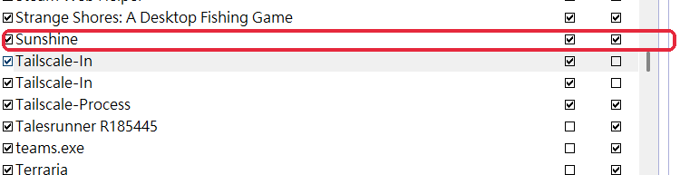


（Tailscale-In 只勾私人是 Tailscale 自己的預設，不用動。）

### 5-7 出門前先測試

在家把手機 Wi-Fi 關掉、改用行動網路連一次。成功代表出門也能用，失敗的話還在家可以馬上修。

---

## 6. 連別人的電腦 / 互相連

**對方（被連）要做的：**

1. 安裝 Sunshine、設好管理密碼。
2. 不在同一個網路時：安裝 Tailscale，用**他自己的帳號**登入（不要共用帳號）。
3. 到 `https://login.tailscale.com/admin/machines` → 他電腦那列的「…」→ **Share** → 複製連結傳給你。
   - **Reusable** 不要勾（一次性連結比較安全，未使用的連結 30 天後過期）。

**你要做的：**

1. 點對方的分享連結，用你的 Tailscale 帳號接受 → 你的清單會出現他的電腦和一組 `100.x.x.x`。
2. Moonlight 按 ＋ 輸入**他的** `100.x.x.x` → PIN 傳給他 → 他在**他的** Sunshine PIN 頁輸入。

**互相連**：就是對稱再做一次——你把你的電腦 Share 給他、他裝 Moonlight、你在你的 Sunshine 輸入 PIN。被連的一方只需要 Sunshine，要去連別人才需要 Moonlight。

> [!CAUTION]
> 配對＝對方能**完全操作**你的電腦。只給信任的人；不想讓他再連，到 Tailscale 後台撤銷分享，或在 Sunshine 取消該裝置配對。

---

## 7. Moonlight 設定與使用技巧

### 7-1 電腦版建議設定（齒輪 → 設定）

| 設定 | 建議 | 效果 |
|---|---|---|
| 顯示模式 | **視窗化**（或無邊框視窗） | 不會整個蓋住自己的電腦 |
| 為遠端桌面而非遊戲最佳化滑鼠 | **勾選**（玩 FPS 時取消） | 滑鼠可自由移出視窗，速度跟自己電腦一樣，不受對方滑鼠設定影響 |
| 結束串流後退出主機上的應用程式 | **勾選** | 直接按視窗 ✕ 就完全結束，不會留下暫停狀態 |
| 串流時將主機喇叭靜音 | 依需求 | 取消勾選 = 兩邊都有聲音 |
| 擷取系統鍵盤快捷鍵 | **維持預設（不要選「一律」）** | 見下方說明 |

> [!WARNING]
> **「擷取系統鍵盤快捷鍵」和「切換螢幕」會衝突**
>
> - 設成「一律」：Win + R 等快捷鍵會送到對方電腦，但**切換螢幕快捷鍵會失效**。
> - 解法：維持預設，要開對方的「執行」視窗時，在串流畫面對**對方工作列的開始按鈕按右鍵 → 執行**（工作管理員、檔案總管也在這裡）。

### 7-2 手機版操作

- **叫鍵盤**：三指同時快速點一下螢幕（OPPO、realme、小米等有「三指截圖」的手機要先關掉該手勢）；阿西西版可從返回鍵叫出的選單開「软键盘」。
- **點哪裡就點哪裡**：設定裡關掉「將觸控螢幕作為觸控板使用」。
- **不能兩指縮放**：改對方電腦的「顯示 → 縮放比例」到 150% 以上最實用。
- **最順手**：接藍牙鍵盤滑鼠或手把。

### 7-3 打中文

- 手機系統鍵盤在 Moonlight 裡可能被鎖在英文，可以先試著換成 **Gboard** 注音。
- 被鎖住時：手機用英文鍵盤、**對方電腦切注音**，照大千注音位置按鍵（例：「你好」= `S U 3`、`C L 3`）。
- 電腦連線時最方便：在自己電腦打好中文複製 → 按 **Ctrl + Alt + Shift + V** 送過去。

### 7-4 卡頓：「與電腦連線過慢，降低位元速率」

1. 位元速率先調到 **5～10 Mbps**（外網）。
2. 解析度 **720p**、幀數 60（還卡就 30）。
3. 編碼器選 **HEVC**。
4. 還是慢：檢查家裡**上傳速度**（串流是家裡電腦上傳畫面），或在電腦執行 `tailscale status` 看是 `direct`（直連）還是 `relay`（轉送，較慢）。

### 7-5 雙螢幕

串流一次只會傳一個螢幕。切換方式：Ctrl + Alt + Shift + F1 / F2（Sunshine 官方功能），或把視窗用 Win + Shift + ← / → 搬過來，或在對方 Sunshine「Configuration → Audio/Video」固定串流某個螢幕。

---

## 8. 快捷鍵總表（電腦版 Moonlight）

| 快捷鍵 | 功能 |
|---|---|
| Ctrl + Alt + Shift + **Q** | 結束串流 |
| Ctrl + Alt + Shift + **X** | 全螢幕 / 視窗切換 |
| Ctrl + Alt + Shift + **Z** | 鎖定 / 放開滑鼠鍵盤 |
| Ctrl + Alt + Shift + **S** | 效能資訊（延遲、位元率、幀數） |
| Ctrl + Alt + Shift + **D** | 最小化串流視窗 |
| Ctrl + Alt + Shift + **M** | 切換滑鼠模式 |
| Ctrl + Alt + Shift + **V** | 把自己電腦複製的文字打到對方電腦 |
| Ctrl + Alt + Shift + **F1 / F2** | 切換串流第 1 / 2 個螢幕（Sunshine） |
| Ctrl + Alt + Shift + **N** | 隱藏 / 顯示游標（Sunshine） |
| 手把 Start + Select + L1 + R1 | 結束串流 |

> Q、Z、X、S 出自 Moonlight 官方發布說明；F1/F12、N 出自 Sunshine 官方文件；其餘為網路整理，可能因版本不同而無效。

### 8-1 正常用法（不使用懸浮按鈕）

懸浮按鍵只是「幫你按快捷鍵」的輔助工具，**不裝也能完整使用**，而且不會被遊戲的反作弊擋到。以下是每個功能不靠懸浮按鍵的做法：

| 想做的事 | 電腦上的做法 | 手機上的做法 |
|---|---|---|
| 切換螢幕 1 / 2 | Ctrl + Alt + Shift + **F1** / **F2** | 接藍牙鍵盤按同組快捷鍵；或請對方在 Sunshine 設定固定串流哪個螢幕 |
| 複製（對方電腦） | 點一下串流畫面，按 **Ctrl + C** | 長按選取 → 右鍵選單「複製」 |
| 把自己的文字送過去 | 在自己電腦複製 → 按 Ctrl + Alt + Shift + **V** | 叫出鍵盤直接打字 |
| 放開滑鼠 | Ctrl + Alt + Shift + **Z** | 不需要 |
| 全螢幕 / 視窗 | Ctrl + Alt + Shift + **X** | 不需要 |
| 調串流聲音 | 右鍵工作列音量圖示 → **音量混合器** → 調 Moonlight 那一條 | 用手機音量鍵 |
| 結束串流 | Ctrl + Alt + Shift + **Q**，或勾「結束串流後退出主機上的應用程式」後直接按視窗 ✕ | 按返回鍵離開 → Moonlight 主畫面點電腦 → 按 **■** |
| 開對方的「執行」視窗 | 對方工作列**開始按鈕按右鍵 → 執行** | 同左（長按開始按鈕） |

**記快捷鍵的小訣竅**
- 所有 Moonlight 快捷鍵都是 **Ctrl + Alt + Shift** 開頭，左手按住這三個，右手按最後一個字母就好。
- 最常用的只有三個：**Z**（放開滑鼠）、**X**（切換視窗）、**Q**（結束）。

> 搭配第 7-1 節的三個建議設定（視窗化、為遠端桌面最佳化滑鼠、結束串流後退出應用程式），日常遠端其實只會用到「切換螢幕」和「貼上文字」兩組快捷鍵。

---

## 9. 自製懸浮按鍵（AutoHotkey）

快捷鍵要同時按四個鍵太麻煩，所以用 **AutoHotkey** 做了一個像手機懸浮球的「懸浮豬寶」。

### 9-1 AutoHotkey 是什麼

Windows 上免費開源的小工具，專門做自動按鍵、自訂快捷鍵、小視窗。Windows 看不懂 `.ahk` 檔，要先安裝它才能執行（官網 [autohotkey.com](https://www.autohotkey.com)，**要裝 v2**）。

裝好會出現主控台 Dash，不用在這裡做任何事，可以關掉：

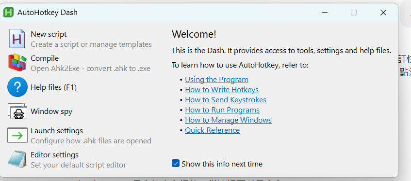


### 9-2 功能

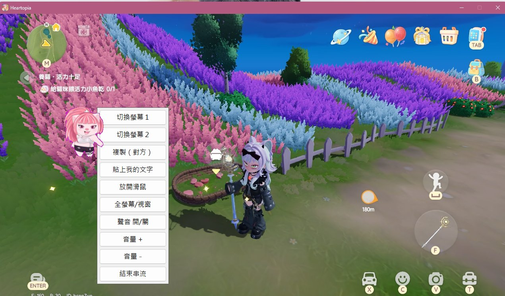


- **跟著 Moonlight 開關**：用捷徑開啟時會順便打開 Moonlight；關掉 Moonlight，豬寶自動結束，平常不會留在背景。
- 串流畫面在使用中時，畫面右側自動出現**全身豬寶**（透明背景）；切到別的程式、最小化、結束串流自動隱藏。
- **按住拖動**移動位置；**點一下**展開 / 收起選單。
- 選單：切換螢幕 1、切換螢幕 2、複製（對方）、貼上我的文字、放開滑鼠、全螢幕/視窗、聲音開/關、音量 +、音量 −、結束串流、**關閉豬寶**。
- 用到一半不想要按鈕：點「**關閉豬寶**」，豬寶結束，Moonlight 和串流照常使用。
- 聲音按鈕調的是「Moonlight 播出來的聲音」＝你聽到的對方電腦聲音，不影響自己其他程式。

> [!NOTE]
> **「複製（對方）」的限制**：Moonlight 不會把對方電腦複製的內容傳回你的電腦，所以只能在對方電腦裡貼上。反方向（自己 → 對方）用「貼上我的文字」。

### 9-3 安裝

1. 把 `Moonlight按鍵.ahk` 和 `pig.png` 放在**同一個資料夾**（`pig.png` 檔名不要改，要用全身去背版；找不到圖片會變回灰色 ☰ 圓點）。
2. 對 `Moonlight按鍵.ahk` 按右鍵 → **建立捷徑** → 拖到桌面，改名「**Moonlight（豬寶）**」。
3. 要遠端時點這個捷徑：Moonlight 會自動打開，系統匣出現綠色 **H** 代表豬寶在待命；關掉 Moonlight，綠色 H 自動消失。

| 想要 | 點哪個 |
|---|---|
| 有懸浮按鈕 | **Moonlight（豬寶）** 捷徑 |
| 不要按鈕 | 原本的 **Moonlight** 圖示 |

> [!CAUTION]
> **不要放進開機啟動資料夾**（`shell:startup`）！開機就在背景執行的 AutoHotkey 會被 AVA 等遊戲的反作弊擋掉（見筆記最前面）。
>
> ❌ 錯誤示範（舊版做法，捷徑放在啟動資料夾）：
>
> 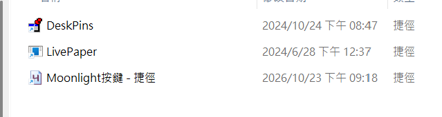
>
> 如果以前放過，`Win + R` 輸入 `shell:startup`，把「Moonlight按鍵 - 捷徑」刪掉。

改了新版本：覆蓋原檔（同位置同檔名）→ 綠色 H 右鍵 → **Reload Script**（或關掉 Moonlight 再用捷徑重開）。

> Moonlight 預設裝在 `C:\Program Files\Moonlight Game Streaming\`；跳出「找不到 Moonlight」時，修改程式碼裡的 `MOONLIGHT_PATH`。

> [!WARNING]
> - 要搭配「為遠端桌面最佳化滑鼠」，否則滑鼠被鎖在串流畫面裡點不到豬寶。
> - 全螢幕模式可能蓋住豬寶，用「視窗化」或「無邊框視窗」。
> - 踩過的坑：AutoHotkey v2 變數**不分大小寫**（`DOT` 和 `dot` 是同一個），也不能跟內建類別撞名（例如 `menu` 撞到 `Menu`）。
複製以下程式碼，用記事本存成 `Moonlight按鍵.ahk`（編碼選 UTF-8）即可使用。

<details>
<summary>📄 Moonlight按鍵.ahk 完整程式碼（點開）</summary>

```autohotkey
#Requires AutoHotkey v2.0
#SingleInstance Force
Persistent

; ===== Moonlight 懸浮豬寶（全身版） =====
; 串流畫面在使用中時，畫面上會出現一個可拖動的小圓點：
;   - 按住拖動：移動豬寶位置（會記住相對於串流畫面的位置）
;   - 點一下：展開 / 收起功能選單
; 切到其他程式、最小化或結束串流時自動隱藏。

; ---------- 跟著 Moonlight 開關 ----------
; 執行這個檔案時，會順便打開 Moonlight；Moonlight 關掉後，豬寶也會自動結束。
; 所以平常（例如玩有反作弊的遊戲時）豬寶不會在背景執行。
MOONLIGHT_PATH := A_ProgramFiles "\Moonlight Game Streaming\Moonlight.exe"   ; Moonlight 安裝位置
if !ProcessExist("Moonlight.exe") {
    if FileExist(MOONLIGHT_PATH)
        Run(MOONLIGHT_PATH)
    else {
        MsgBox("找不到 Moonlight：`n" MOONLIGHT_PATH "`n`n請先手動開啟 Moonlight，或修改檔案裡的 MOONLIGHT_PATH。", "Moonlight 按鍵")
    }
}
if !ProcessWait("Moonlight.exe", 20)   ; 最多等 20 秒讓 Moonlight 開起來
    ExitApp()

; Moonlight 的串流畫面視窗（SDL 視窗）
STREAM_WIN := "ahk_class SDL_app ahk_exe Moonlight.exe"
DOT_W := 75     ; 懸浮豬寶寬度（像素，要跟 pig.png 一樣）
DOT_H := 96     ; 懸浮豬寶高度
TRANS_COLOR := "FF00FF" ; 透明用的底色（不用改）
ICON := A_ScriptDir "\pig.png"   ; 小圓點圖案，放在跟這個檔案同一個資料夾

; ---------- 小圓點 ----------
; +E0x08000000 = 點擊時不搶走焦點，Moonlight 保持在使用中
dotGui := Gui("+AlwaysOnTop +ToolWindow -Caption +E0x08000000")
dotGui.MarginX := 0
dotGui.MarginY := 0
if FileExist(ICON) {
    ; 背景設成洋紅色，再把洋紅色變透明 → 只看得到豬寶本身
    dotGui.BackColor := TRANS_COLOR
    dotGui.Add("Picture", "x0 y0 w" DOT_W " h" DOT_H " BackgroundTrans", ICON)
    dotGui.Show("w" DOT_W " h" DOT_H " Hide")
    WinSetTransColor(TRANS_COLOR, dotGui.Hwnd)
} else {                                   ; 找不到圖片時用灰色 ☰ 圓點
    DOT_W := 44, DOT_H := 44
    dotGui.BackColor := "2B2B2B"
    dotGui.SetFont("s16 cWhite", "Segoe UI Symbol")
    dotGui.Add("Text", "x0 y0 w44 h44 Center +0x200 BackgroundTrans", "☰")
    dotGui.Show("w44 h44 Hide")
    WinSetRegion("0-0 W44 H44 E", dotGui.Hwnd)
}

; ---------- 功能選單 ----------
menuGui := Gui("+AlwaysOnTop +ToolWindow -Caption +Border +E0x08000000")
menuGui.MarginX := 4
menuGui.MarginY := 4
menuGui.SetFont("s10", "Microsoft JhengHei")

AddBtn("切換螢幕 1",    "^!+{F1}")
AddBtn("切換螢幕 2",    "^!+{F2}")
AddBtn("複製（對方）",  "^c")       ; 在對方電腦複製，只能在對方電腦貼上
AddBtn("貼上我的文字",  "^!+v")     ; 把我這台複製的文字打到對方電腦
AddBtn("放開滑鼠",      "^!+z")
AddBtn("全螢幕/視窗",   "^!+x")
AddBtn("聲音 開/關",  (*) => MoonlightAudio("mute"))
AddBtn("音量 +",      (*) => MoonlightAudio(+10))
AddBtn("音量 −",      (*) => MoonlightAudio(-10))
AddBtn("結束串流",      "^!+q")
AddBtn("關閉豬寶",      (*) => ExitApp())   ; 這次不想用按鈕：豬寶結束，Moonlight 照常使用

menuGui.Show("AutoSize Hide")
menuGui.GetPos(, , &mw, &mh)

; ---------- 狀態 ----------
ox := ""          ; 小圓點相對於串流畫面左上角的位置
oy := ""
dotShown := false
menuOpen := false
dragging := false
lastX := ""
lastY := ""

OnMessage(0x201, OnDotDown)   ; 滑鼠左鍵按下
SetTimer(CheckStream, 200)
return

; =====================================================

AddBtn(label, action) {
    global menuGui
    btn := menuGui.Add("Button", "w130 h30", label)
    if (action is String)
        btn.OnEvent("Click", (*) => (HideMenu(), SendToMoonlight(action)))
    else
        btn.OnEvent("Click", (*) => action())   ; 聲音按鈕：選單保持開著，方便連按
}

Clamp(v, lo, hi) {
    return v < lo ? lo : (v > hi ? hi : v)
}

CheckStream() {
    global dotGui, dotShown, menuOpen, dragging, ox, oy, lastX, lastY
    if !ProcessExist("Moonlight.exe")   ; Moonlight 關掉了 → 豬寶跟著結束
        ExitApp()
    if dragging
        return
    if WinExist(STREAM_WIN) && WinActive(STREAM_WIN) && WinGetMinMax(STREAM_WIN) != -1 {
        WinGetClientPos(&cx, &cy, &cw, &ch, STREAM_WIN)
        if (ox = "") {                 ; 第一次出現：放在右側上方三分之一處
            ox := cw - DOT_W - 10
            oy := ch // 3
        }
        ox := Clamp(ox, 0, Max(cw - DOT_W, 0))
        oy := Clamp(oy, 0, Max(ch - DOT_H, 0))
        nx := cx + ox
        ny := cy + oy
        if (!dotShown || nx != lastX || ny != lastY) {
            dotGui.Show("x" nx " y" ny " NoActivate")
            lastX := nx
            lastY := ny
            if menuOpen
                PositionMenu()
        }
        dotShown := true
    } else {
        if dotShown {
            dotGui.Hide()
            dotShown := false
        }
        HideMenu()
    }
}

OnDotDown(wParam, lParam, msg, hwnd) {
    global dotGui, dragging, ox, oy
    ; 只處理點在小圓點上的情況
    if !(hwnd = dotGui.Hwnd || DllCall("GetParent", "ptr", hwnd, "ptr") = dotGui.Hwnd)
        return
    CoordMode("Mouse", "Screen")
    MouseGetPos(&mx0, &my0)
    WinGetPos(&wx0, &wy0, , , dotGui.Hwnd)
    dragging := true
    moved := false
    while GetKeyState("LButton", "P") {
        MouseGetPos(&mx, &my)
        if (!moved && (Abs(mx - mx0) > 5 || Abs(my - my0) > 5)) {
            moved := true
            HideMenu()
        }
        if moved
            WinMove(wx0 + mx - mx0, wy0 + my - my0, , , dotGui.Hwnd)
        Sleep(10)
    }
    dragging := false
    if moved {
        ; 記住新位置（相對於串流畫面）
        if WinExist(STREAM_WIN) {
            WinGetPos(&nx, &ny, , , dotGui.Hwnd)
            WinGetClientPos(&cx, &cy, &cw, &ch, STREAM_WIN)
            ox := Clamp(nx - cx, 0, Max(cw - DOT_W, 0))
            oy := Clamp(ny - cy, 0, Max(ch - DOT_H, 0))
        }
    } else {
        ToggleMenu()
    }
    return 0
}

ToggleMenu() {
    global menuOpen
    if menuOpen
        HideMenu()
    else
        ShowMenu()
}

ShowMenu() {
    global menuOpen
    menuOpen := true
    PositionMenu()
}

PositionMenu() {
    global menuGui, dotGui, mw, mh
    WinGetPos(&dx, &dy, , , dotGui.Hwnd)
    if WinExist(STREAM_WIN) {
        WinGetClientPos(&cx, &cy, &cw, &ch, STREAM_WIN)
    } else {
        cx := 0, cy := 0, cw := A_ScreenWidth, ch := A_ScreenHeight
    }
    ; 小圓點在右半邊 → 選單開在左側；在左半邊 → 開在右側
    if (dx + DOT_W // 2 > cx + cw // 2)
        mx := dx - mw - 6
    else
        mx := dx + DOT_W + 6
    my := Clamp(dy, cy, Max(cy + ch - mh, cy))
    menuGui.Show("x" mx " y" my " NoActivate")
}

HideMenu() {
    global menuGui, menuOpen
    if menuOpen {
        menuGui.Hide()
        menuOpen := false
    }
}

SendToMoonlight(keys) {
    if !WinExist(STREAM_WIN)
        return
    WinActivate(STREAM_WIN)
    if !WinWaitActive(STREAM_WIN, , 1)
        return
    Sleep(150)
    ; 用較慢、每個鍵按住一下的方式送出，Moonlight 比較不會漏收組合鍵
    SetKeyDelay(30, 40)
    SendEvent(keys)
}

; =====================================================
; 聲音控制：只調整「Moonlight 播出來的串流聲音」（= 你聽到的對方電腦聲音）
; 不會動到你自己電腦其他程式的音量，也不會改對方電腦的設定
; action = "mute" 切換靜音；數字 = 音量加減（百分比）
; =====================================================
MoonlightAudio(action) {
    vols := GetAppVolumes("Moonlight.exe")
    if (vols.Length = 0) {
        ShowTip("找不到 Moonlight 的聲音（串流中要有聲音播放過才抓得到）")
        return
    }
    if (action = "mute") {
        ComCall(6, vols[1], "int*", &m := 0)           ; GetMute
        for v in vols
            ComCall(5, v, "int", !m, "ptr", 0)          ; SetMute
        ShowTip(m ? "串流聲音：開" : "串流聲音：靜音")
    } else {
        ComCall(4, vols[1], "float*", &cur := 0)        ; GetMasterVolume
        nv := Max(0, Min(1, cur + action / 100))
        for v in vols {
            ComCall(3, v, "float", nv, "ptr", 0)        ; SetMasterVolume
            ComCall(5, v, "int", 0, "ptr", 0)           ; 調音量時順便解除靜音
        }
        ShowTip("串流音量：" Round(nv * 100) "%")
    }
}

GetAppVolumes(exeName) {
    vols := []
    pid := ProcessExist(exeName)
    if !pid
        return vols
    devEnum := ComObject("{BCDE0395-E52F-467C-8E3D-C4579291692E}", "{A95664D2-9614-4F35-A746-DE8DB63617E6}")
    ComCall(4, devEnum, "int", 0, "int", 1, "ptr*", &pDev := 0)          ; GetDefaultAudioEndpoint(喇叭)
    dev := ComValue(13, pDev)
    IID_Mgr2 := Buffer(16)
    DllCall("ole32\CLSIDFromString", "wstr", "{77AA99A0-1BD6-484F-8BC7-2C654C9A9B6F}", "ptr", IID_Mgr2)
    ComCall(3, dev, "ptr", IID_Mgr2, "uint", 23, "ptr", 0, "ptr*", &pMgr := 0)   ; Activate
    mgr := ComValue(13, pMgr)
    ComCall(5, mgr, "ptr*", &pSE := 0)                                ; GetSessionEnumerator
    se := ComValue(13, pSE)
    ComCall(3, se, "int*", &cnt := 0)                                 ; GetCount
    loop cnt {
        ComCall(4, se, "int", A_Index - 1, "ptr*", &pCtl := 0)        ; GetSession
        ctl := ComValue(13, pCtl)
        ctl2 := ComObjQuery(ctl, "{bfb7ff88-7239-4fc9-8fa2-07c950be9c6d}")
        ComCall(14, ctl2, "uint*", &sPid := 0)                        ; GetProcessId
        if (sPid = pid)
            vols.Push(ComObjQuery(ctl, "{87CE5498-68D6-44E5-9215-6DA47EF883D8}"))   ; ISimpleAudioVolume
    }
    return vols
}

ShowTip(msg) {
    ToolTip(msg)
    SetTimer(() => ToolTip(), -1500)
}
```

</details>

---

## 10. 日常使用與關閉

### 重開機後

不會自動連上，但**不用重新設定、不用重新配對**：打開 Moonlight（要懸浮按鈕就點「Moonlight（豬寶）」捷徑）→ 點電腦 → Desktop。

- 被連那台：Sunshine 開機自動啟動；Tailscale 有勾 Run unattended 就自動連線；停在 Windows 登入畫面就連進去輸入密碼。
- 連不上：檢查兩邊 Tailscale 都是 Connected、被連那台系統匣有 Sunshine 太陽圖示。

### 想關掉遠端（由輕到重）

1. **暫停**：系統匣太陽圖示右鍵 → Quit（重開機會自己再啟動）。
2. **只擋外面**：Tailscale 圖示右鍵 → Disconnect（家裡 Wi-Fi 還能連）。
3. **取消某台裝置**：Sunshine 管理頁移除該裝置配對。
4. **完全不用**：解除安裝 Sunshine 和 Tailscale，並在 Tailscale 後台移除電腦。

---

## 參考資料

- [Sunshine GitHub Releases](https://github.com/LizardByte/Sunshine/releases)
- [Sunshine 官方文件：Getting Started（含快捷鍵）](https://docs.lizardbyte.dev/projects/sunshine/latest/md_docs_2getting__started.html)
- [Moonlight 官網](https://moonlight-stream.org)
- [Moonlight PC 版 GitHub](https://github.com/moonlight-stream/moonlight-qt)
- [Moonlight 官方設定指南](https://github.com/moonlight-stream/moonlight-docs/wiki/Setup-Guide)
- [月光·阿西西（Android 修改版）](https://github.com/Axixi2233/moonlight-android)
- [VoidLink（iOS，App Store 中國區）](https://apps.apple.com/cn/app/voidlink/id6747717070)
- [Tailscale：分享電腦給其他使用者](https://tailscale.com/kb/1084/sharing)
- [AutoHotkey 官網](https://www.autohotkey.com)